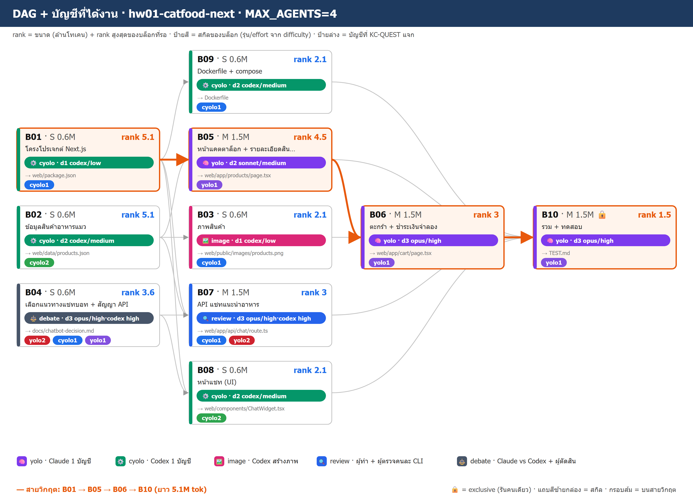
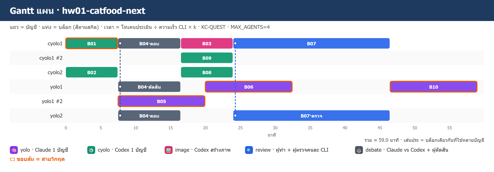

# PLAN · hw01-catfood-next

**โจทย์:** อยากทำเว็บขายอาหารแมว ใช้ Next.js กับ Docker มีแชทบอทช่วยแนะนำอาหาร

วางแผนเมื่อ 15/11/2026 14:09 · MAX_AGENTS 4 · บัญชี cyolo1, cyolo2, yolo1, yolo2 · ตัวปรับเวลา k (ยังไม่มี calib.json → k=1)

> แผนนี้ยังไม่ได้รันจริง — KC-QUEST เลือกบัญชีจากโควตา แล้วจำลองเวลาตาม dependency

## 1) โควตาของแต่ละบัญชี

| บัญชี | แพลน | ใช้ไป 5 ชม. | ใช้ไปสัปดาห์ | headroom | รีเซ็ต/หมดอายุ (ชม.) | U | slot | ที่มา |
|---|---|---|---|---|---|---|---|---|
| cyolo1 | default | 10% | 0% | **90%** | 168.0 | 0.125 | 3 | สมมติ (--accounts) |
| cyolo2 | default | 30% | 0% | **70%** | 168.0 | 0.125 | 3 | สมมติ (--accounts) |
| yolo1 | default | 20% | 0% | **80%** | 168.0 | 0.125 | 3 | สมมติ (--accounts) |
| yolo2 | default | 40% | 0% | **60%** | 168.0 | 0.125 | 3 | สมมติ (--accounts) |

- ⚠ ทุกบัญชีเป็นค่าสมมติ (--accounts มี % ครบ) → ไม่ได้เรียก team.py check/quota

## 2) DAG + สกิล + บัญชี

**สายวิกฤต:** B01 → B05 → B06 → B10 · ยาว 5.1M tok

## 3) ตารางแจกงาน (เหตุผล KC-QUEST ทุกบล็อก)

| บล็อก | สกิล | ชื่อ | ขนาด · c | รอ | rank | บัญชี (บทบาท) | เริ่ม–จบ (นาที) | เหตุผล KC-QUEST |
|---|---|---|---|---|---|---|---|---|
| **B01** | ⚙️ cyolo | โครงโปรเจกต์ Next.js | S · 0.6 | – | 5.1 | cyolo1 (ทำ) | 0.0–7.5 | ทำ: cyolo1 28.8 (U=0.125 F=0.002 S=0.884 S=0.7 L=0.0) · 0.60M ≈ 5ชม. 1.56% / สัปดาห์ 0.2% · อันดับ 2 cyolo2 25.8 |
| B02 | ⚙️ cyolo | ข้อมูลสินค้าอาหารแมว | S · 0.6 | – | 5.1 | cyolo2 (ทำ) | 0.0–7.5 | ทำ: cyolo2 25.8 (U=0.125 F=0.002 S=0.684 S=0.7 L=0.0) · 0.60M ≈ 5ชม. 1.56% / สัปดาห์ 0.2% · อันดับ 2 cyolo1 25.2 |
| **B05** | 🧠 yolo | หน้าแคตตาล็อก + รายละเอียดสินค้า | M · 1.5 | B01, B02 | 4.5 | yolo1 (ทำ) | 7.5–20.0 | ทำ: yolo1 29.7 (U=0.125 F=0.005 S=0.761 S=0.882 L=0.0) · 1.50M ≈ 5ชม. 3.9% / สัปดาห์ 0.49% · อันดับ 2 yolo2 26.7 |
| B04 | ⚖️ debate | เลือกแนวทางแชทบอท + สัญญา API | S · 0.6 | – | 3.6 | yolo2 (ตอบ), cyolo1 (ตอบ), yolo1 (ตัดสิน) | 7.5–16.5 | ตอบ: yolo2 24.4 (U=0.125 F=0.002 S=0.584 S=0.706 L=0.0) · 0.60M ≈ 5ชม. 1.56% / สัปดาห์ 0.2% · อันดับ 2 yolo1 23.5   ตอบ: cyolo1 25.5 (U=0.125 F=0.002 S=0.869 S=0.494 L=0.0) · 0.60M ≈ 5ชม. 1.56% / สัปดาห์ 0.2% · อันดับ 2 cyolo2 22.5   ตัดสิน: yolo1 23.6 (U=0.125 F=0.001 S=0.756 S=0.706 L=0.333) · 0.18M ≈ 5ชม. 0.47% / สัปดาห์ 0.06% · อันดับ 2 cyolo2 22.6 |
| B03 | 🖼️ image | ภาพสินค้า | S · 0.6 | B02 | 2.1 | cyolo1 (ทำ) | 16.5–24.0 | ทำ: cyolo1 22.2 (U=0.125 F=0.002 S=0.853 S=0.288 L=0.0) · 0.60M ≈ 5ชม. 1.56% / สัปดาห์ 0.2% · อันดับ 2 cyolo2 19.4 |
| B08 | ⚙️ cyolo | หน้าแชท (UI) | S · 0.6 | B01, B04 | 2.1 | cyolo2 (ทำ) | 16.5–24.0 | ทำ: cyolo2 19.4 (U=0.125 F=0.002 S=0.669 S=0.288 L=0.0) · 0.60M ≈ 5ชม. 1.56% / สัปดาห์ 0.2% · อันดับ 2 cyolo1 18.6 |
| B09 | ⚙️ cyolo | Dockerfile + compose | S · 0.6 | B01 | 2.1 | cyolo1 (ทำ) | 16.5–24.0 | ทำ: cyolo1 18.6 (U=0.125 F=0.002 S=0.838 S=0.288 L=0.333) · 0.60M ≈ 5ชม. 1.56% / สัปดาห์ 0.2% · อันดับ 2 cyolo2 15.8 |
| **B06** | 🧠 yolo | ตะกร้า + ชำระเงินจำลอง | M · 1.5 | B05 | 3 | yolo1 (ทำ) | 20.0–32.5 | ทำ: yolo1 24.7 (U=0.125 F=0.005 S=0.717 S=0.588 L=0.0) · 1.50M ≈ 5ชม. 3.9% / สัปดาห์ 0.49% · อันดับ 2 yolo2 22.1 |
| B07 | 🔍 review | API แชทแนะนำอาหาร | M · 1.5 | B01, B02, B04 | 3 | cyolo1 (ทำ), yolo2 (ตรวจ) | 24.0–46.5 | ทำ: cyolo1 23.3 (U=0.125 F=0.005 S=0.799 S=0.412 L=0.0) · 1.50M ≈ 5ชม. 3.9% / สัปดาห์ 0.49% · อันดับ 2 yolo2 22.1   ตรวจ: yolo2 22.4 (U=0.125 F=0.001 S=0.573 S=0.588 L=0.0) · 0.45M ≈ 5ชม. 1.17% / สัปดาห์ 0.15% · อันดับ 2 yolo1 21.1 |
| **B10** | 🧠 yolo | รวม + ทดสอบ | M · 1.5 | B03, B05, B06, B07, B08, B09 | 1.5 | yolo1 (ทำ) | 46.5–59.0 | ทำ: yolo1 19.7 (U=0.125 F=0.005 S=0.678 S=0.294 L=0.0) · 1.50M ≈ 5ชม. 3.9% / สัปดาห์ 0.49% · อันดับ 2 yolo2 17.5 |

## 4) Gantt แผน

## 5) รอบแจกงาน

| นาทีที่ | บล็อกที่เริ่ม |
|---|---|
| 0 | B01→cyolo1, B02→cyolo2 |
| 7.5 | B05→yolo1, B04→yolo2+cyolo1+yolo1 |
| 16.5 | B03→cyolo1, B08→cyolo2, B09→cyolo1 |
| 20 | B06→yolo1 |
| 24 | B07→cyolo1+yolo2 |
| 46.5 | B10→yolo1 |

## 6) สรุป

- บล็อก 10 · แจกได้ 10 · agent พร้อมกันสูงสุด 4/4
- เวลาประมาณ 59.0 นาที (แท่ง Gantt) · ไฟล์ผลของทีม: `C:/CWN2026-homework/.work/plans\hw01-catfood-next\app/`

ต่อไป: `dagplan.py export hw01-catfood-next` → `dagplan.py run hw01-catfood-next` → `dagplan.py report hw01-catfood-next`
