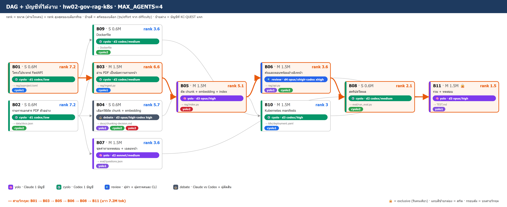
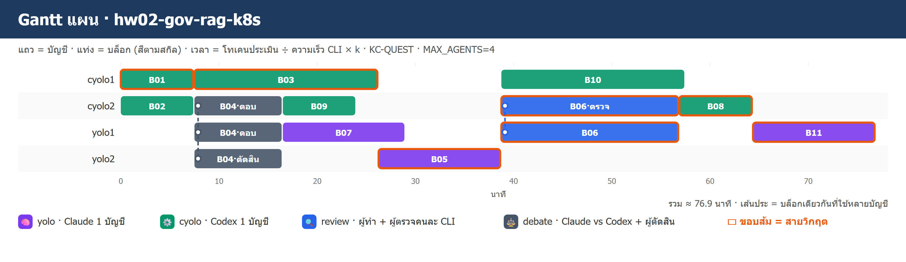

# PLAN · hw02-gov-rag-k8s

**โจทย์:** ระบบ RAG ถามตอบเอกสารภาครัฐ (ประกาศและระเบียบแบบ PDF) ตอบพร้อมอ้างอิงหน้าเอกสาร และ deployment ด้วย Kubernetes

วางแผนเมื่อ 15/11/2026 14:09 · MAX_AGENTS 4 · บัญชี cyolo1, cyolo2, yolo1, yolo2 · ตัวปรับเวลา k (ยังไม่มี calib.json → k=1)

> แผนนี้ยังไม่ได้รันจริง — KC-QUEST เลือกบัญชีจากโควตา แล้วจำลองเวลาตาม dependency

## 1) โควตาของแต่ละบัญชี

| บัญชี | แพลน | ใช้ไป 5 ชม. | ใช้ไปสัปดาห์ | headroom | รีเซ็ต/หมดอายุ (ชม.) | U | slot | ที่มา |
|---|---|---|---|---|---|---|---|---|
| cyolo1 | default | 10% | 0% | **90%** | 168.0 | 0.125 | 3 | สมมติ (--accounts) |
| cyolo2 | default | 30% | 0% | **70%** | 168.0 | 0.125 | 3 | สมมติ (--accounts) |
| yolo1 | default | 20% | 0% | **80%** | 168.0 | 0.125 | 3 | สมมติ (--accounts) |
| yolo2 | default | 40% | 0% | **60%** | 168.0 | 0.125 | 3 | สมมติ (--accounts) |

- ⚠ ทุกบัญชีเป็นค่าสมมติ (--accounts มี % ครบ) → ไม่ได้เรียก team.py check/quota

## 2) DAG + สกิล + บัญชี

**สายวิกฤต:** B01 → B03 → B05 → B06 → B08 → B11 · ยาว 7.2M tok

## 3) ตารางแจกงาน (เหตุผล KC-QUEST ทุกบล็อก)

| บล็อก | สกิล | ชื่อ | ขนาด · c | รอ | rank | บัญชี (บทบาท) | เริ่ม–จบ (นาที) | เหตุผล KC-QUEST |
|---|---|---|---|---|---|---|---|---|
| **B01** | ⚙️ cyolo | โครงโปรเจกต์ FastAPI | S · 0.6 | – | 7.2 | cyolo1 (ทำ) | 0.0–7.5 | ทำ: cyolo1 28.8 (U=0.125 F=0.002 S=0.884 S=0.7 L=0.0) · 0.60M ≈ 5ชม. 1.56% / สัปดาห์ 0.2% · อันดับ 2 cyolo2 25.8 |
| B02 | ⚙️ cyolo | รายการเอกสาร PDF ตัวอย่าง | S · 0.6 | – | 7.2 | cyolo2 (ทำ) | 0.0–7.5 | ทำ: cyolo2 25.8 (U=0.125 F=0.002 S=0.684 S=0.7 L=0.0) · 0.60M ≈ 5ชม. 1.56% / สัปดาห์ 0.2% · อันดับ 2 cyolo1 25.2 |
| **B03** | ⚙️ cyolo | อ่าน PDF เป็นข้อความรายหน้า | M · 1.5 | B01, B02 | 6.6 | cyolo1 (ทำ) | 7.5–26.2 | ทำ: cyolo1 27.4 (U=0.125 F=0.005 S=0.845 S=0.642 L=0.0) · 1.50M ≈ 5ชม. 3.9% / สัปดาห์ 0.49% · อันดับ 2 cyolo2 24.4 |
| B04 | ⚖️ debate | เลือกวิธีตัด chunk + embedding | S · 0.6 | B02 | 5.7 | yolo1 (ตอบ), cyolo2 (ตอบ), yolo2 (ตัดสิน) | 7.5–16.5 | ตอบ: yolo1 28.7 (U=0.125 F=0.002 S=0.784 S=0.792 L=0.0) · 0.60M ≈ 5ชม. 1.56% / สัปดาห์ 0.2% · อันดับ 2 yolo2 25.7   ตอบ: cyolo2 23.4 (U=0.125 F=0.002 S=0.669 S=0.554 L=0.0) · 0.60M ≈ 5ชม. 1.56% / สัปดาห์ 0.2% · อันดับ 2 cyolo1 22.5   ตัดสิน: yolo2 25.8 (U=0.125 F=0.001 S=0.595 S=0.792 L=0.0) · 0.18M ≈ 5ชม. 0.47% / สัปดาห์ 0.06% · อันดับ 2 cyolo1 22.6 |
| B07 | 🧠 yolo | ชุดคำถามทดสอบ + เฉลยหน้า | M · 1.5 | B02 | 3.6 | yolo1 (ทำ) | 16.5–29.0 | ทำ: yolo1 23.8 (U=0.125 F=0.005 S=0.745 S=0.5 L=0.0) · 1.50M ≈ 5ชม. 3.9% / สัปดาห์ 0.49% · อันดับ 2 yolo2 20.9 |
| B09 | ⚙️ cyolo | Dockerfile | S · 0.6 | B01 | 3.6 | cyolo2 (ทำ) | 16.5–24.0 | ทำ: cyolo2 20.1 (U=0.125 F=0.002 S=0.653 S=0.35 L=0.0) · 0.60M ≈ 5ชม. 1.56% / สัปดาห์ 0.2% · อันดับ 2 cyolo1 19.4 |
| **B05** | 🧠 yolo | ตัด chunk + embedding + index | M · 1.5 | B03, B04 | 5.1 | yolo2 (ทำ) | 26.2–38.7 | ทำ: yolo2 24.1 (U=0.125 F=0.005 S=0.556 S=0.708 L=0.0) · 1.50M ≈ 5ชม. 3.9% / สัปดาห์ 0.49% · อันดับ 2 yolo1 23.0 |
| **B06** | 🔍 review | ค้นและตอบพร้อมอ้างอิงหน้า | M · 1.5 | B05 | 3.6 | yolo1 (ทำ), cyolo2 (ตรวจ) | 38.7–56.9 | ทำ: yolo1 23.2 (U=0.125 F=0.005 S=0.706 S=0.5 L=0.0) · 1.50M ≈ 5ชม. 3.9% / สัปดาห์ 0.49% · อันดับ 2 yolo2 20.4   ตรวจ: cyolo2 19.9 (U=0.125 F=0.001 S=0.641 S=0.35 L=0.0) · 0.45M ≈ 5ชม. 1.17% / สัปดาห์ 0.15% · อันดับ 2 cyolo1 18.9 |
| B10 | ⚙️ cyolo | Kubernetes manifests | M · 1.5 | B05, B09 | 3 | cyolo1 (ทำ) | 38.7–57.5 | ทำ: cyolo1 21.6 (U=0.125 F=0.005 S=0.806 S=0.292 L=0.0) · 1.50M ≈ 5ชม. 3.9% / สัปดาห์ 0.49% · อันดับ 2 cyolo2 18.7 |
| **B08** | ⚙️ cyolo | สคริปต์วัดผล | S · 0.6 | B06, B07 | 2.1 | cyolo2 (ทำ) | 56.9–64.4 | ทำ: cyolo2 17.5 (U=0.125 F=0.002 S=0.626 S=0.204 L=0.0) · 0.60M ≈ 5ชม. 1.56% / สัปดาห์ 0.2% · อันดับ 2 cyolo1 16.6 |
| **B11** | 🧠 yolo | รวม + ทดสอบ | M · 1.5 | B06, B08, B10 | 1.5 | yolo1 (ทำ) | 64.4–76.9 | ทำ: yolo1 18.2 (U=0.125 F=0.005 S=0.667 S=0.208 L=0.0) · 1.50M ≈ 5ชม. 3.9% / สัปดาห์ 0.49% · อันดับ 2 yolo2 16.0 |

## 4) Gantt แผน

## 5) รอบแจกงาน

| นาทีที่ | บล็อกที่เริ่ม |
|---|---|
| 0 | B01→cyolo1, B02→cyolo2 |
| 7.5 | B03→cyolo1, B04→yolo1+cyolo2+yolo2 |
| 16.5 | B07→yolo1, B09→cyolo2 |
| 26.2 | B05→yolo2 |
| 38.7 | B10→cyolo1, B06→yolo1+cyolo2 |
| 56.9 | B08→cyolo2 |
| 64.4 | B11→yolo1 |

## 6) สรุป

- บล็อก 11 · แจกได้ 11 · agent พร้อมกันสูงสุด 4/4
- เวลาประมาณ 76.9 นาที (แท่ง Gantt) · ไฟล์ผลของทีม: `C:/CWN2026-homework/.work/plans\hw02-gov-rag-k8s\app/`

ต่อไป: `dagplan.py export hw02-gov-rag-k8s` → `dagplan.py run hw02-gov-rag-k8s` → `dagplan.py report hw02-gov-rag-k8s`
