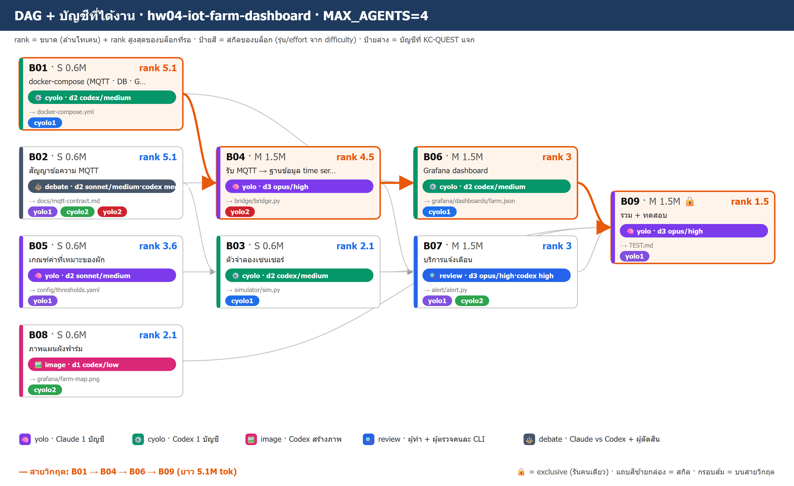
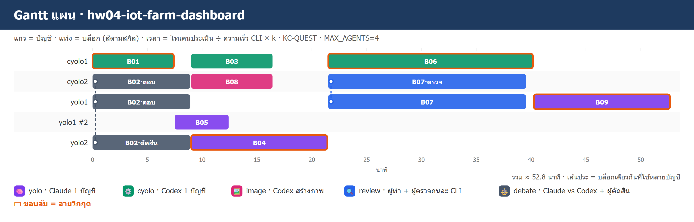

# PLAN · hw04-iot-farm-dashboard

**โจทย์:** ระบบ IoT ฟาร์มผัก เซนเซอร์ส่งค่าผ่าน MQTT เก็บลงฐานข้อมูล time series แสดงผลบน Grafana และแจ้งเตือนเมื่อค่าเกินเกณฑ์ ทั้งหมดรันด้วย Docker Compose

วางแผนเมื่อ 15/11/2026 14:09 · MAX_AGENTS 4 · บัญชี cyolo1, cyolo2, yolo1, yolo2 · ตัวปรับเวลา k (ยังไม่มี calib.json → k=1)

> แผนนี้ยังไม่ได้รันจริง — KC-QUEST เลือกบัญชีจากโควตา แล้วจำลองเวลาตาม dependency

## 1) โควตาของแต่ละบัญชี

| บัญชี | แพลน | ใช้ไป 5 ชม. | ใช้ไปสัปดาห์ | headroom | รีเซ็ต/หมดอายุ (ชม.) | U | slot | ที่มา |
|---|---|---|---|---|---|---|---|---|
| cyolo1 | default | 10% | 0% | **90%** | 168.0 | 0.125 | 3 | สมมติ (--accounts) |
| cyolo2 | default | 30% | 0% | **70%** | 168.0 | 0.125 | 3 | สมมติ (--accounts) |
| yolo1 | default | 20% | 0% | **80%** | 168.0 | 0.125 | 3 | สมมติ (--accounts) |
| yolo2 | default | 40% | 0% | **60%** | 168.0 | 0.125 | 3 | สมมติ (--accounts) |

- ⚠ ทุกบัญชีเป็นค่าสมมติ (--accounts มี % ครบ) → ไม่ได้เรียก team.py check/quota

## 2) DAG + สกิล + บัญชี

**สายวิกฤต:** B01 → B04 → B06 → B09 · ยาว 5.1M tok

## 3) ตารางแจกงาน (เหตุผล KC-QUEST ทุกบล็อก)

| บล็อก | สกิล | ชื่อ | ขนาด · c | รอ | rank | บัญชี (บทบาท) | เริ่ม–จบ (นาที) | เหตุผล KC-QUEST |
|---|---|---|---|---|---|---|---|---|
| **B01** | ⚙️ cyolo | docker-compose (MQTT · DB · Grafana) | S · 0.6 | – | 5.1 | cyolo1 (ทำ) | 0.0–7.5 | ทำ: cyolo1 28.8 (U=0.125 F=0.002 S=0.884 S=0.7 L=0.0) · 0.60M ≈ 5ชม. 1.56% / สัปดาห์ 0.2% · อันดับ 2 cyolo2 25.8 |
| B02 | ⚖️ debate | สัญญาข้อความ MQTT | S · 0.6 | – | 5.1 | yolo1 (ตอบ), cyolo2 (ตอบ), yolo2 (ตัดสิน) | 0.0–9.0 | ตอบ: yolo1 31.8 (U=0.125 F=0.002 S=0.784 S=1.0 L=0.0) · 0.60M ≈ 5ชม. 1.56% / สัปดาห์ 0.2% · อันดับ 2 yolo2 28.8   ตอบ: cyolo2 25.8 (U=0.125 F=0.002 S=0.684 S=0.7 L=0.0) · 0.60M ≈ 5ชม. 1.56% / สัปดาห์ 0.2% · อันดับ 2 cyolo1 25.2   ตัดสิน: yolo2 28.9 (U=0.125 F=0.001 S=0.595 S=1.0 L=0.0) · 0.18M ≈ 5ชม. 0.47% / สัปดาห์ 0.06% · อันดับ 2 cyolo1 25.4 |
| B05 | 🧠 yolo | เกณฑ์ค่าที่เหมาะของผัก | S · 0.6 | – | 3.6 | yolo1 (ทำ) | 7.5–12.5 | ทำ: yolo1 23.8 (U=0.125 F=0.002 S=0.769 S=0.706 L=0.333) · 0.60M ≈ 5ชม. 1.56% / สัปดาห์ 0.2% · อันดับ 2 yolo2 21.0 |
| **B04** | 🧠 yolo | รับ MQTT → ฐานข้อมูล time series | M · 1.5 | B01, B02 | 4.5 | yolo2 (ทำ) | 9.0–21.5 | ทำ: yolo2 26.7 (U=0.125 F=0.005 S=0.556 S=0.882 L=0.0) · 1.50M ≈ 5ชม. 3.9% / สัปดาห์ 0.49% · อันดับ 2 yolo1 25.9 |
| B03 | ⚙️ cyolo | ตัวจำลองเซนเซอร์ | S · 0.6 | B02 | 2.1 | cyolo1 (ทำ) | 9.0–16.5 | ทำ: cyolo1 22.4 (U=0.125 F=0.002 S=0.869 S=0.288 L=0.0) · 0.60M ≈ 5ชม. 1.56% / สัปดาห์ 0.2% · อันดับ 2 cyolo2 19.4 |
| B08 | 🖼️ image | ภาพแผนผังฟาร์ม | S · 0.6 | – | 2.1 | cyolo2 (ทำ) | 9.0–16.5 | ทำ: cyolo2 19.4 (U=0.125 F=0.002 S=0.669 S=0.288 L=0.0) · 0.60M ≈ 5ชม. 1.56% / สัปดาห์ 0.2% · อันดับ 2 cyolo1 18.8 |
| **B06** | ⚙️ cyolo | Grafana dashboard | M · 1.5 | B01, B04 | 3 | cyolo1 (ทำ) | 21.5–40.2 | ทำ: cyolo1 23.7 (U=0.125 F=0.005 S=0.83 S=0.412 L=0.0) · 1.50M ≈ 5ชม. 3.9% / สัปดาห์ 0.49% · อันดับ 2 cyolo2 20.7 |
| B07 | 🔍 review | บริการแจ้งเตือน | M · 1.5 | B04, B05 | 3 | yolo1 (ทำ), cyolo2 (ตรวจ) | 21.5–39.6 | ทำ: yolo1 24.9 (U=0.125 F=0.005 S=0.73 S=0.588 L=0.0) · 1.50M ≈ 5ชม. 3.9% / สัปดาห์ 0.49% · อันดับ 2 yolo2 21.7   ตรวจ: cyolo2 21.1 (U=0.125 F=0.001 S=0.657 S=0.412 L=0.0) · 0.45M ≈ 5ชม. 1.17% / สัปดาห์ 0.15% · อันดับ 2 cyolo1 20.1 |
| **B09** | 🧠 yolo | รวม + ทดสอบ | M · 1.5 | B03, B06, B07, B08 | 1.5 | yolo1 (ทำ) | 40.2–52.8 | ทำ: yolo1 19.9 (U=0.125 F=0.005 S=0.691 S=0.294 L=0.0) · 1.50M ≈ 5ชม. 3.9% / สัปดาห์ 0.49% · อันดับ 2 yolo2 17.3 |

## 4) Gantt แผน

## 5) รอบแจกงาน

| นาทีที่ | บล็อกที่เริ่ม |
|---|---|
| 0 | B01→cyolo1, B02→yolo1+cyolo2+yolo2 |
| 7.5 | B05→yolo1 |
| 9 | B04→yolo2, B03→cyolo1, B08→cyolo2 |
| 21.5 | B06→cyolo1, B07→yolo1+cyolo2 |
| 40.2 | B09→yolo1 |

## 6) สรุป

- บล็อก 9 · แจกได้ 9 · agent พร้อมกันสูงสุด 4/4
- เวลาประมาณ 52.8 นาที (แท่ง Gantt) · ไฟล์ผลของทีม: `C:/CWN2026-homework/.work/plans\hw04-iot-farm-dashboard\app/`

ต่อไป: `dagplan.py export hw04-iot-farm-dashboard` → `dagplan.py run hw04-iot-farm-dashboard` → `dagplan.py report hw04-iot-farm-dashboard`
