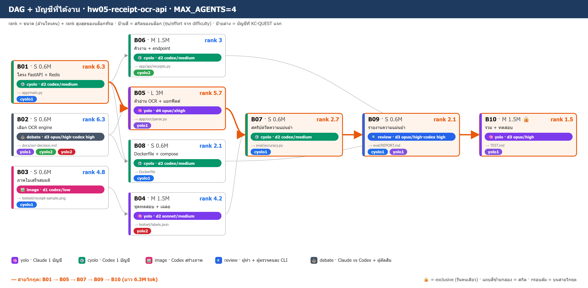
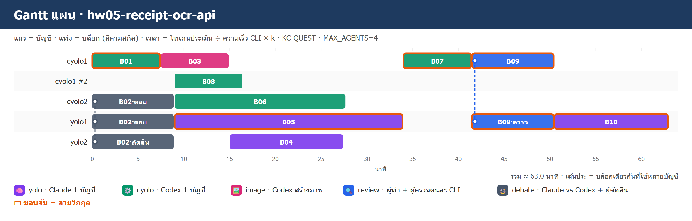

# PLAN · hw05-receipt-ocr-api

**โจทย์:** API อ่านใบเสร็จภาษาไทย (OCR) ด้วย FastAPI มีคิวงาน รันใน Docker และมีรายงานความแม่นยำจากชุดทดสอบ

วางแผนเมื่อ 15/11/2026 14:09 · MAX_AGENTS 4 · บัญชี cyolo1, cyolo2, yolo1, yolo2 · ตัวปรับเวลา k (ยังไม่มี calib.json → k=1)

> แผนนี้ยังไม่ได้รันจริง — KC-QUEST เลือกบัญชีจากโควตา แล้วจำลองเวลาตาม dependency

## 1) โควตาของแต่ละบัญชี

| บัญชี | แพลน | ใช้ไป 5 ชม. | ใช้ไปสัปดาห์ | headroom | รีเซ็ต/หมดอายุ (ชม.) | U | slot | ที่มา |
|---|---|---|---|---|---|---|---|---|
| cyolo1 | default | 10% | 0% | **90%** | 168.0 | 0.125 | 3 | สมมติ (--accounts) |
| cyolo2 | default | 30% | 0% | **70%** | 168.0 | 0.125 | 3 | สมมติ (--accounts) |
| yolo1 | default | 20% | 0% | **80%** | 168.0 | 0.125 | 3 | สมมติ (--accounts) |
| yolo2 | default | 40% | 0% | **60%** | 168.0 | 0.125 | 3 | สมมติ (--accounts) |

- ⚠ ทุกบัญชีเป็นค่าสมมติ (--accounts มี % ครบ) → ไม่ได้เรียก team.py check/quota

## 2) DAG + สกิล + บัญชี

**สายวิกฤต:** B01 → B05 → B07 → B09 → B10 · ยาว 6.3M tok

## 3) ตารางแจกงาน (เหตุผล KC-QUEST ทุกบล็อก)

| บล็อก | สกิล | ชื่อ | ขนาด · c | รอ | rank | บัญชี (บทบาท) | เริ่ม–จบ (นาที) | เหตุผล KC-QUEST |
|---|---|---|---|---|---|---|---|---|
| **B01** | ⚙️ cyolo | โครง FastAPI + Redis | S · 0.6 | – | 6.3 | cyolo1 (ทำ) | 0.0–7.5 | ทำ: cyolo1 28.8 (U=0.125 F=0.002 S=0.884 S=0.7 L=0.0) · 0.60M ≈ 5ชม. 1.56% / สัปดาห์ 0.2% · อันดับ 2 cyolo2 25.8 |
| B02 | ⚖️ debate | เลือก OCR engine | S · 0.6 | – | 6.3 | yolo1 (ตอบ), cyolo2 (ตอบ), yolo2 (ตัดสิน) | 0.0–9.0 | ตอบ: yolo1 31.8 (U=0.125 F=0.002 S=0.784 S=1.0 L=0.0) · 0.60M ≈ 5ชม. 1.56% / สัปดาห์ 0.2% · อันดับ 2 yolo2 28.8   ตอบ: cyolo2 25.8 (U=0.125 F=0.002 S=0.684 S=0.7 L=0.0) · 0.60M ≈ 5ชม. 1.56% / สัปดาห์ 0.2% · อันดับ 2 cyolo1 25.2   ตัดสิน: yolo2 28.9 (U=0.125 F=0.001 S=0.595 S=1.0 L=0.0) · 0.18M ≈ 5ชม. 0.47% / สัปดาห์ 0.06% · อันดับ 2 cyolo1 25.4 |
| B03 | 🖼️ image | ภาพใบเสร็จสมมติ | S · 0.6 | – | 4.8 | cyolo1 (ทำ) | 7.5–15.0 | ทำ: cyolo1 26.1 (U=0.125 F=0.002 S=0.869 S=0.533 L=0.0) · 0.60M ≈ 5ชม. 1.56% / สัปดาห์ 0.2% · อันดับ 2 cyolo2 19.7 |
| **B05** | 🧠 yolo | ตัวอ่าน OCR + แยกฟิลด์ | L · 3 | B01, B02 | 5.7 | yolo1 (ทำ) | 9.0–34.0 | ทำ: yolo1 29.4 (U=0.125 F=0.01 S=0.706 S=0.905 L=0.0) · 3.00M ≈ 5ชม. 7.8% / สัปดาห์ 0.98% · อันดับ 2 yolo2 26.5 |
| B06 | ⚙️ cyolo | คิวงาน + endpoint | M · 1.5 | B01 | 3 | cyolo2 (ทำ) | 9.0–27.8 | ทำ: cyolo2 19.8 (U=0.125 F=0.005 S=0.645 S=0.333 L=0.0) · 1.50M ≈ 5ชม. 3.9% / สัปดาห์ 0.49% · อันดับ 2 cyolo1 19.2 |
| B08 | ⚙️ cyolo | Dockerfile + compose | S · 0.6 | B01, B02 | 2.1 | cyolo1 (ทำ) | 9.0–16.5 | ทำ: cyolo1 18.0 (U=0.125 F=0.002 S=0.853 S=0.233 L=0.333) · 0.60M ≈ 5ชม. 1.56% / สัปดาห์ 0.2% · อันดับ 2 cyolo2 14.7 |
| B04 | 🧠 yolo | ชุดทดสอบ + เฉลย | M · 1.5 | B03 | 4.2 | yolo2 (ทำ) | 15.0–27.5 | ทำ: yolo2 23.4 (U=0.125 F=0.005 S=0.556 S=0.667 L=0.0) · 1.50M ≈ 5ชม. 3.9% / สัปดาห์ 0.49% · อันดับ 2 yolo1 21.8 |
| **B07** | ⚙️ cyolo | สคริปต์วัดความแม่นยำ | S · 0.6 | B04, B05 | 2.7 | cyolo1 (ทำ) | 34.0–41.5 | ทำ: cyolo1 22.1 (U=0.125 F=0.002 S=0.838 S=0.3 L=0.0) · 0.60M ≈ 5ชม. 1.56% / สัปดาห์ 0.2% · อันดับ 2 cyolo2 19.0 |
| **B09** | 🔍 review | รายงานความแม่นยำ | S · 0.6 | B07 | 2.1 | cyolo1 (ทำ), yolo1 (ตรวจ) | 41.5–50.5 | ทำ: cyolo1 20.9 (U=0.125 F=0.002 S=0.822 S=0.233 L=0.0) · 0.60M ≈ 5ชม. 1.56% / สัปดาห์ 0.2% · อันดับ 2 yolo1 20.4   ตรวจ: yolo1 20.5 (U=0.125 F=0.001 S=0.702 S=0.333 L=0.0) · 0.18M ≈ 5ชม. 0.47% / สัปดาห์ 0.06% · อันดับ 2 yolo2 18.3 |
| **B10** | 🧠 yolo | รวม + ทดสอบ | M · 1.5 | B06, B08, B09 | 1.5 | yolo1 (ทำ) | 50.5–63.0 | ทำ: yolo1 18.6 (U=0.125 F=0.005 S=0.663 S=0.238 L=0.0) · 1.50M ≈ 5ชม. 3.9% / สัปดาห์ 0.49% · อันดับ 2 yolo2 16.4 |

## 4) Gantt แผน

## 5) รอบแจกงาน

| นาทีที่ | บล็อกที่เริ่ม |
|---|---|
| 0 | B01→cyolo1, B02→yolo1+cyolo2+yolo2 |
| 7.5 | B03→cyolo1 |
| 9 | B05→yolo1, B06→cyolo2, B08→cyolo1 |
| 15 | B04→yolo2 |
| 34 | B07→cyolo1 |
| 41.5 | B09→cyolo1+yolo1 |
| 50.5 | B10→yolo1 |

## 6) สรุป

- บล็อก 10 · แจกได้ 10 · agent พร้อมกันสูงสุด 4/4
- เวลาประมาณ 63.0 นาที (แท่ง Gantt) · ไฟล์ผลของทีม: `C:/CWN2026-homework/.work/plans\hw05-receipt-ocr-api\app/`

ต่อไป: `dagplan.py export hw05-receipt-ocr-api` → `dagplan.py run hw05-receipt-ocr-api` → `dagplan.py report hw05-receipt-ocr-api`
