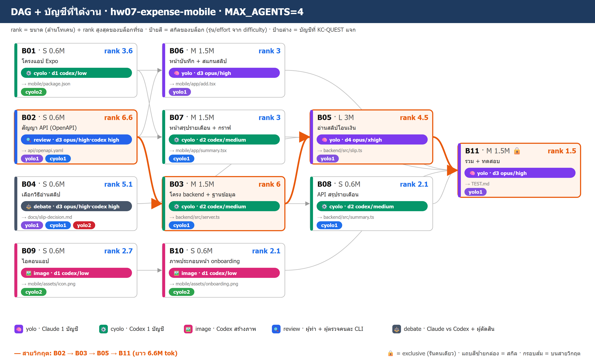
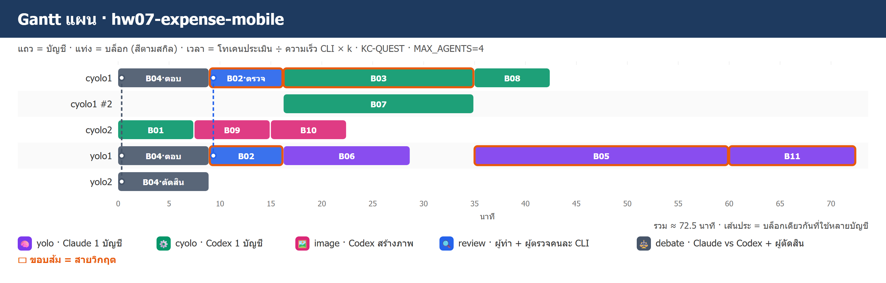

# PLAN · hw07-expense-mobile

**โจทย์:** แอปมือถือบันทึกรายจ่าย สแกนสลิปโอนเงินแล้วกรอกให้อัตโนมัติ มี backend เก็บข้อมูล และสรุปรายจ่ายรายเดือนเป็นกราฟ

วางแผนเมื่อ 15/11/2026 14:09 · MAX_AGENTS 4 · บัญชี cyolo1, cyolo2, yolo1, yolo2 · ตัวปรับเวลา k (ยังไม่มี calib.json → k=1)

> แผนนี้ยังไม่ได้รันจริง — KC-QUEST เลือกบัญชีจากโควตา แล้วจำลองเวลาตาม dependency

## 1) โควตาของแต่ละบัญชี

| บัญชี | แพลน | ใช้ไป 5 ชม. | ใช้ไปสัปดาห์ | headroom | รีเซ็ต/หมดอายุ (ชม.) | U | slot | ที่มา |
|---|---|---|---|---|---|---|---|---|
| cyolo1 | default | 10% | 0% | **90%** | 168.0 | 0.125 | 3 | สมมติ (--accounts) |
| cyolo2 | default | 30% | 0% | **70%** | 168.0 | 0.125 | 3 | สมมติ (--accounts) |
| yolo1 | default | 20% | 0% | **80%** | 168.0 | 0.125 | 3 | สมมติ (--accounts) |
| yolo2 | default | 40% | 0% | **60%** | 168.0 | 0.125 | 3 | สมมติ (--accounts) |

- ⚠ ทุกบัญชีเป็นค่าสมมติ (--accounts มี % ครบ) → ไม่ได้เรียก team.py check/quota

## 2) DAG + สกิล + บัญชี

**สายวิกฤต:** B02 → B03 → B05 → B11 · ยาว 6.6M tok

## 3) ตารางแจกงาน (เหตุผล KC-QUEST ทุกบล็อก)

| บล็อก | สกิล | ชื่อ | ขนาด · c | รอ | rank | บัญชี (บทบาท) | เริ่ม–จบ (นาที) | เหตุผล KC-QUEST |
|---|---|---|---|---|---|---|---|---|
| B04 | ⚖️ debate | เลือกวิธีอ่านสลิป | S · 0.6 | – | 5.1 | yolo1 (ตอบ), cyolo1 (ตอบ), yolo2 (ตัดสิน) | 0.0–9.0 | ตอบ: yolo1 28.4 (U=0.125 F=0.002 S=0.784 S=0.773 L=0.0) · 0.60M ≈ 5ชม. 1.56% / สัปดาห์ 0.2% · อันดับ 2 yolo2 25.4   ตอบ: cyolo1 26.4 (U=0.125 F=0.002 S=0.884 S=0.541 L=0.0) · 0.60M ≈ 5ชม. 1.56% / สัปดาห์ 0.2% · อันดับ 2 cyolo2 23.4   ตัดสิน: yolo2 25.5 (U=0.125 F=0.001 S=0.595 S=0.773 L=0.0) · 0.18M ≈ 5ชม. 0.47% / สัปดาห์ 0.06% · อันดับ 2 cyolo2 23.6 |
| B01 | ⚙️ cyolo | โครงแอป Expo | S · 0.6 | – | 3.6 | cyolo2 (ทำ) | 0.0–7.5 | ทำ: cyolo2 21.0 (U=0.125 F=0.002 S=0.684 S=0.382 L=0.0) · 0.60M ≈ 5ชม. 1.56% / สัปดาห์ 0.2% · อันดับ 2 cyolo1 20.5 |
| B09 | 🖼️ image | ไอคอนแอป | S · 0.6 | – | 2.7 | cyolo2 (ทำ) | 7.5–15.0 | ทำ: cyolo2 19.4 (U=0.125 F=0.002 S=0.669 S=0.286 L=0.0) · 0.60M ≈ 5ชม. 1.56% / สัปดาห์ 0.2% · อันดับ 2 cyolo1 19.0 |
| **B02** | 🔍 review | สัญญา API (OpenAPI) | S · 0.6 | – | 6.6 | yolo1 (ทำ), cyolo1 (ตรวจ) | 9.0–16.2 | ทำ: yolo1 31.6 (U=0.125 F=0.002 S=0.769 S=1.0 L=0.0) · 0.60M ≈ 5ชม. 1.56% / สัปดาห์ 0.2% · อันดับ 2 yolo2 28.7   ตรวจ: cyolo1 28.7 (U=0.125 F=0.001 S=0.88 S=0.7 L=0.0) · 0.18M ≈ 5ชม. 0.47% / สัปดาห์ 0.06% · อันดับ 2 cyolo2 22.1 |
| B10 | 🖼️ image | ภาพประกอบหน้า onboarding | S · 0.6 | B09 | 2.1 | cyolo2 (ทำ) | 15.0–22.5 | ทำ: cyolo2 18.2 (U=0.125 F=0.002 S=0.653 S=0.223 L=0.0) · 0.60M ≈ 5ชม. 1.56% / สัปดาห์ 0.2% · อันดับ 2 cyolo1 18.0 |
| **B03** | ⚙️ cyolo | โครง backend + ฐานข้อมูล | M · 1.5 | B02 | 6 | cyolo1 (ทำ) | 16.2–35.0 | ทำ: cyolo1 27.3 (U=0.125 F=0.005 S=0.841 S=0.636 L=0.0) · 1.50M ≈ 5ชม. 3.9% / สัปดาห์ 0.49% · อันดับ 2 cyolo2 20.5 |
| B06 | 🧠 yolo | หน้าบันทึก + สแกนสลิป | M · 1.5 | B01, B02 | 3 | yolo1 (ทำ) | 16.2–28.7 | ทำ: yolo1 22.9 (U=0.125 F=0.005 S=0.73 S=0.455 L=0.0) · 1.50M ≈ 5ชม. 3.9% / สัปดาห์ 0.49% · อันดับ 2 yolo2 20.3 |
| B07 | ⚙️ cyolo | หน้าสรุปรายเดือน + กราฟ | M · 1.5 | B01, B02 | 3 | cyolo1 (ทำ) | 16.2–35.0 | ทำ: cyolo1 18.6 (U=0.125 F=0.005 S=0.802 S=0.319 L=0.333) · 1.50M ≈ 5ชม. 3.9% / สัปดาห์ 0.49% · อันดับ 2 cyolo2 15.8 |
| **B05** | 🧠 yolo | อ่านสลิปโอนเงิน | L · 3 | B03, B04 | 4.5 | yolo1 (ทำ) | 35.0–60.0 | ทำ: yolo1 25.2 (U=0.125 F=0.01 S=0.652 S=0.682 L=0.0) · 3.00M ≈ 5ชม. 7.8% / สัปดาห์ 0.98% · อันดับ 2 yolo2 23.2 |
| B08 | ⚙️ cyolo | API สรุปรายเดือน | S · 0.6 | B03 | 2.1 | cyolo1 (ทำ) | 35.0–42.5 | ทำ: cyolo1 20.2 (U=0.125 F=0.002 S=0.786 S=0.223 L=0.0) · 0.60M ≈ 5ชม. 1.56% / สัปดาห์ 0.2% · อันดับ 2 cyolo2 18.0 |
| **B11** | 🧠 yolo | รวม + ทดสอบ | M · 1.5 | B05, B06, B07, B08, B10 | 1.5 | yolo1 (ทำ) | 60.0–72.5 | ทำ: yolo1 17.7 (U=0.125 F=0.005 S=0.613 S=0.227 L=0.0) · 1.50M ≈ 5ชม. 3.9% / สัปดาห์ 0.49% · อันดับ 2 yolo2 16.8 |

## 4) Gantt แผน

## 5) รอบแจกงาน

| นาทีที่ | บล็อกที่เริ่ม |
|---|---|
| 0 | B04→yolo1+cyolo1+yolo2, B01→cyolo2 |
| 7.5 | B09→cyolo2 |
| 9 | B02→yolo1+cyolo1 |
| 15 | B10→cyolo2 |
| 16.2 | B03→cyolo1, B06→yolo1, B07→cyolo1 |
| 35 | B05→yolo1, B08→cyolo1 |
| 60 | B11→yolo1 |

## 6) สรุป

- บล็อก 11 · แจกได้ 11 · agent พร้อมกันสูงสุด 4/4
- เวลาประมาณ 72.5 นาที (แท่ง Gantt) · ไฟล์ผลของทีม: `C:/CWN2026-homework/.work/plans\hw07-expense-mobile\app/`

ต่อไป: `dagplan.py export hw07-expense-mobile` → `dagplan.py run hw07-expense-mobile` → `dagplan.py report hw07-expense-mobile`
