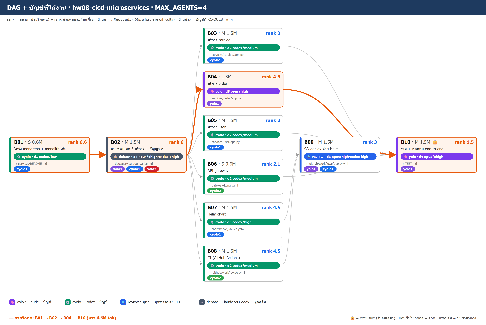
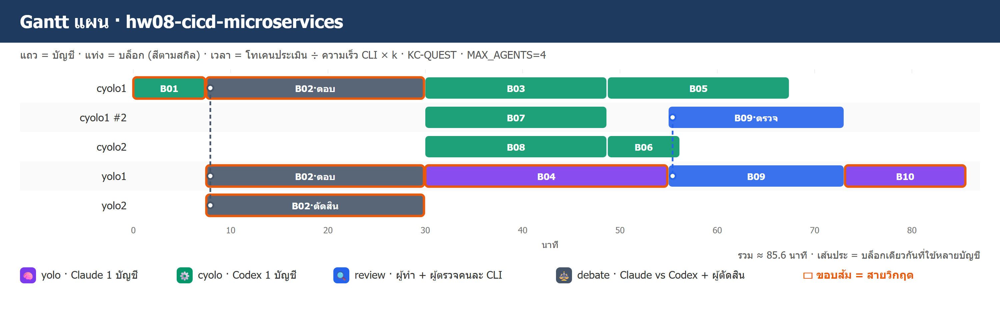

# PLAN · hw08-cicd-microservices

**โจทย์:** แยกระบบร้านค้าเดิม (monolith) เป็น 3 microservices มี API gateway CI/CD ด้วย GitHub Actions และ deploy ขึ้น Kubernetes ด้วย Helm

วางแผนเมื่อ 15/11/2026 14:09 · MAX_AGENTS 4 · บัญชี cyolo1, cyolo2, yolo1, yolo2 · ตัวปรับเวลา k (ยังไม่มี calib.json → k=1)

> แผนนี้ยังไม่ได้รันจริง — KC-QUEST เลือกบัญชีจากโควตา แล้วจำลองเวลาตาม dependency

## 1) โควตาของแต่ละบัญชี

| บัญชี | แพลน | ใช้ไป 5 ชม. | ใช้ไปสัปดาห์ | headroom | รีเซ็ต/หมดอายุ (ชม.) | U | slot | ที่มา |
|---|---|---|---|---|---|---|---|---|
| cyolo1 | default | 10% | 0% | **90%** | 168.0 | 0.125 | 3 | สมมติ (--accounts) |
| cyolo2 | default | 30% | 0% | **70%** | 168.0 | 0.125 | 3 | สมมติ (--accounts) |
| yolo1 | default | 20% | 0% | **80%** | 168.0 | 0.125 | 3 | สมมติ (--accounts) |
| yolo2 | default | 40% | 0% | **60%** | 168.0 | 0.125 | 3 | สมมติ (--accounts) |

- ⚠ ทุกบัญชีเป็นค่าสมมติ (--accounts มี % ครบ) → ไม่ได้เรียก team.py check/quota

## 2) DAG + สกิล + บัญชี

**สายวิกฤต:** B01 → B02 → B04 → B10 · ยาว 6.6M tok

## 3) ตารางแจกงาน (เหตุผล KC-QUEST ทุกบล็อก)

| บล็อก | สกิล | ชื่อ | ขนาด · c | รอ | rank | บัญชี (บทบาท) | เริ่ม–จบ (นาที) | เหตุผล KC-QUEST |
|---|---|---|---|---|---|---|---|---|
| **B01** | ⚙️ cyolo | โครง monorepo + monolith เดิม | S · 0.6 | – | 6.6 | cyolo1 (ทำ) | 0.0–7.5 | ทำ: cyolo1 28.8 (U=0.125 F=0.002 S=0.884 S=0.7 L=0.0) · 0.60M ≈ 5ชม. 1.56% / สัปดาห์ 0.2% · อันดับ 2 cyolo2 25.8 |
| **B02** | ⚖️ debate | แบ่งขอบเขต 3 บริการ + สัญญา API | M · 1.5 | B01 | 6 | yolo1 (ตอบ), cyolo1 (ตอบ), yolo2 (ตัดสิน) | 7.5–30.0 | ตอบ: yolo1 30.1 (U=0.125 F=0.005 S=0.761 S=0.909 L=0.0) · 1.50M ≈ 5ชม. 3.9% / สัปดาห์ 0.49% · อันดับ 2 yolo2 27.2   ตอบ: cyolo1 27.3 (U=0.125 F=0.005 S=0.845 S=0.636 L=0.0) · 1.50M ≈ 5ชม. 3.9% / สัปดาห์ 0.49% · อันดับ 2 cyolo2 24.6   ตัดสิน: yolo2 27.5 (U=0.125 F=0.001 S=0.588 S=0.909 L=0.0) · 0.45M ≈ 5ชม. 1.17% / สัปดาห์ 0.15% · อันดับ 2 cyolo2 24.9 |
| **B04** | 🧠 yolo | บริการ order | L · 3 | B02 | 4.5 | yolo1 (ทำ) | 30.0–55.0 | ทำ: yolo1 25.7 (U=0.125 F=0.01 S=0.683 S=0.682 L=0.0) · 3.00M ≈ 5ชม. 7.8% / สัปดาห์ 0.98% · อันดับ 2 yolo2 23.1 |
| B07 | ⚙️ cyolo | Helm chart | M · 1.5 | B02 | 4.5 | cyolo1 (ทำ) | 30.0–48.8 | ทำ: cyolo1 24.3 (U=0.125 F=0.005 S=0.806 S=0.477 L=0.0) · 1.50M ≈ 5ชม. 3.9% / สัปดาห์ 0.49% · อันดับ 2 cyolo2 22.2 |
| B08 | ⚙️ cyolo | CI (GitHub Actions) | M · 1.5 | B02 | 4.5 | cyolo2 (ทำ) | 30.0–48.8 | ทำ: cyolo2 22.2 (U=0.125 F=0.005 S=0.661 S=0.477 L=0.0) · 1.50M ≈ 5ชม. 3.9% / สัปดาห์ 0.49% · อันดับ 2 cyolo1 20.4 |
| B03 | ⚙️ cyolo | บริการ catalog | M · 1.5 | B02 | 3 | cyolo1 (ทำ) | 30.0–48.8 | ทำ: cyolo1 18.1 (U=0.125 F=0.005 S=0.767 S=0.319 L=0.333) · 1.50M ≈ 5ชม. 3.9% / สัปดาห์ 0.49% · อันดับ 2 cyolo2 15.9 |
| B05 | ⚙️ cyolo | บริการ user | M · 1.5 | B02 | 3 | cyolo1 (ทำ) | 48.8–67.5 | ทำ: cyolo1 20.8 (U=0.125 F=0.005 S=0.728 S=0.319 L=0.0) · 1.50M ≈ 5ชม. 3.9% / สัปดาห์ 0.49% · อันดับ 2 cyolo2 19.2 |
| B06 | ⚙️ cyolo | API gateway | S · 0.6 | B02 | 2.1 | cyolo2 (ทำ) | 48.8–56.2 | ทำ: cyolo2 18.1 (U=0.125 F=0.002 S=0.645 S=0.223 L=0.0) · 0.60M ≈ 5ชม. 1.56% / สัปดาห์ 0.2% · อันดับ 2 cyolo1 15.8 |
| B09 | 🔍 review | CD deploy ด้วย Helm | M · 1.5 | B07, B08 | 3 | yolo1 (ทำ), cyolo1 (ตรวจ) | 55.0–73.1 | ทำ: yolo1 21.6 (U=0.125 F=0.005 S=0.644 S=0.455 L=0.0) · 1.50M ≈ 5ชม. 3.9% / สัปดาห์ 0.49% · อันดับ 2 yolo2 20.2   ตรวจ: cyolo1 17.2 (U=0.125 F=0.001 S=0.717 S=0.319 L=0.333) · 0.45M ≈ 5ชม. 1.17% / สัปดาห์ 0.15% · อันดับ 2 cyolo2 16.0 |
| **B10** | 🧠 yolo | รวม + ทดสอบ end-to-end | M · 1.5 | B03, B04, B05, B06, B09 | 1.5 | yolo1 (ทำ) | 73.1–85.6 | ทำ: yolo1 17.6 (U=0.125 F=0.005 S=0.605 S=0.227 L=0.0) · 1.50M ≈ 5ชม. 3.9% / สัปดาห์ 0.49% · อันดับ 2 yolo2 16.7 |

## 4) Gantt แผน

## 5) รอบแจกงาน

| นาทีที่ | บล็อกที่เริ่ม |
|---|---|
| 0 | B01→cyolo1 |
| 7.5 | B02→yolo1+cyolo1+yolo2 |
| 30 | B04→yolo1, B07→cyolo1, B08→cyolo2, B03→cyolo1 |
| 48.8 | B05→cyolo1, B06→cyolo2 |
| 55 | B09→yolo1+cyolo1 |
| 73.1 | B10→yolo1 |

## 6) สรุป

- บล็อก 10 · แจกได้ 10 · agent พร้อมกันสูงสุด 4/4
- เวลาประมาณ 85.6 นาที (แท่ง Gantt) · ไฟล์ผลของทีม: `C:/CWN2026-homework/.work/plans\hw08-cicd-microservices\app/`

ต่อไป: `dagplan.py export hw08-cicd-microservices` → `dagplan.py run hw08-cicd-microservices` → `dagplan.py report hw08-cicd-microservices`
