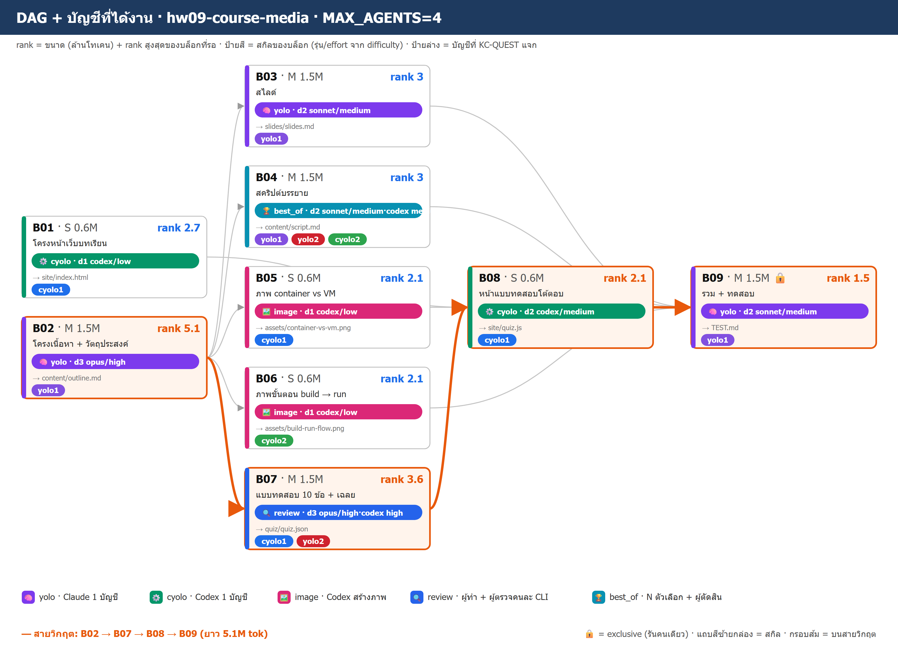
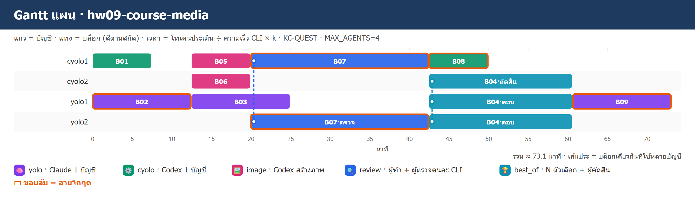

# PLAN · hw09-course-media

**โจทย์:** สื่อการสอนออนไลน์ 1 บทเรื่อง "Docker เบื้องต้น" มีสไลด์ ภาพประกอบ สคริปต์บรรยาย แบบทดสอบ 10 ข้อ และหน้าเว็บรวมทุกอย่าง

วางแผนเมื่อ 15/11/2026 14:10 · MAX_AGENTS 4 · บัญชี cyolo1, cyolo2, yolo1, yolo2 · ตัวปรับเวลา k (ยังไม่มี calib.json → k=1)

> แผนนี้ยังไม่ได้รันจริง — KC-QUEST เลือกบัญชีจากโควตา แล้วจำลองเวลาตาม dependency

## 1) โควตาของแต่ละบัญชี

| บัญชี | แพลน | ใช้ไป 5 ชม. | ใช้ไปสัปดาห์ | headroom | รีเซ็ต/หมดอายุ (ชม.) | U | slot | ที่มา |
|---|---|---|---|---|---|---|---|---|
| cyolo1 | default | 10% | 0% | **90%** | 168.0 | 0.125 | 3 | สมมติ (--accounts) |
| cyolo2 | default | 30% | 0% | **70%** | 168.0 | 0.125 | 3 | สมมติ (--accounts) |
| yolo1 | default | 20% | 0% | **80%** | 168.0 | 0.125 | 3 | สมมติ (--accounts) |
| yolo2 | default | 40% | 0% | **60%** | 168.0 | 0.125 | 3 | สมมติ (--accounts) |

- ⚠ ทุกบัญชีเป็นค่าสมมติ (--accounts มี % ครบ) → ไม่ได้เรียก team.py check/quota

## 2) DAG + สกิล + บัญชี

**สายวิกฤต:** B02 → B07 → B08 → B09 · ยาว 5.1M tok

## 3) ตารางแจกงาน (เหตุผล KC-QUEST ทุกบล็อก)

| บล็อก | สกิล | ชื่อ | ขนาด · c | รอ | rank | บัญชี (บทบาท) | เริ่ม–จบ (นาที) | เหตุผล KC-QUEST |
|---|---|---|---|---|---|---|---|---|
| **B02** | 🧠 yolo | โครงเนื้อหา + วัตถุประสงค์ | M · 1.5 | – | 5.1 | yolo1 (ทำ) | 0.0–12.5 | ทำ: yolo1 31.5 (U=0.125 F=0.005 S=0.761 S=1.0 L=0.0) · 1.50M ≈ 5ชม. 3.9% / สัปดาห์ 0.49% · อันดับ 2 yolo2 28.5 |
| B01 | ⚙️ cyolo | โครงหน้าเว็บบทเรียน | S · 0.6 | – | 2.7 | cyolo1 (ทำ) | 0.0–7.5 | ทำ: cyolo1 23.8 (U=0.125 F=0.002 S=0.884 S=0.37 L=0.0) · 0.60M ≈ 5ชม. 1.56% / สัปดาห์ 0.2% · อันดับ 2 cyolo2 20.9 |
| B03 | 🧠 yolo | สไลด์ | M · 1.5 | B02 | 3 | yolo1 (ทำ) | 12.5–25.0 | ทำ: yolo1 24.7 (U=0.125 F=0.005 S=0.722 S=0.588 L=0.0) · 1.50M ≈ 5ชม. 3.9% / สัปดาห์ 0.49% · อันดับ 2 yolo2 22.3 |
| B05 | 🖼️ image | ภาพ container vs VM | S · 0.6 | B02 | 2.1 | cyolo1 (ทำ) | 12.5–20.0 | ทำ: cyolo1 22.4 (U=0.125 F=0.002 S=0.869 S=0.288 L=0.0) · 0.60M ≈ 5ชม. 1.56% / สัปดาห์ 0.2% · อันดับ 2 cyolo2 19.6 |
| B06 | 🖼️ image | ภาพขั้นตอน build → run | S · 0.6 | B02 | 2.1 | cyolo2 (ทำ) | 12.5–20.0 | ทำ: cyolo2 19.6 (U=0.125 F=0.002 S=0.684 S=0.288 L=0.0) · 0.60M ≈ 5ชม. 1.56% / สัปดาห์ 0.2% · อันดับ 2 cyolo1 18.8 |
| **B07** | 🔍 review | แบบทดสอบ 10 ข้อ + เฉลย | M · 1.5 | B02 | 3.6 | cyolo1 (ทำ), yolo2 (ตรวจ) | 20.0–42.5 | ทำ: cyolo1 25.0 (U=0.125 F=0.005 S=0.83 S=0.494 L=0.0) · 1.50M ≈ 5ชม. 3.9% / สัปดาห์ 0.49% · อันดับ 2 yolo2 24.1   ตรวจ: yolo2 24.4 (U=0.125 F=0.001 S=0.588 S=0.706 L=0.0) · 0.45M ≈ 5ชม. 1.17% / สัปดาห์ 0.15% · อันดับ 2 yolo1 22.9 |
| B04 | 🏆 best_of | สคริปต์บรรยาย | M · 1.5 | B02 | 3 | yolo1 (ตอบ), yolo2 (ตอบ), cyolo2 (ตัดสิน) | 42.5–60.6 | ตอบ: yolo1 24.2 (U=0.125 F=0.005 S=0.683 S=0.588 L=0.0) · 1.50M ≈ 5ชม. 3.9% / สัปดาห์ 0.49% · อันดับ 2 yolo2 22.2   ตอบ: yolo2 22.2 (U=0.125 F=0.005 S=0.549 S=0.588 L=0.0) · 1.50M ≈ 5ชม. 3.9% / สัปดาห์ 0.49% · อันดับ 2 cyolo2 21.0   ตัดสิน: cyolo2 21.3 (U=0.125 F=0.001 S=0.673 S=0.412 L=0.0) · 0.45M ≈ 5ชม. 1.17% / สัปดาห์ 0.15% · อันดับ 2 cyolo1 19.9 |
| **B08** | ⚙️ cyolo | หน้าแบบทดสอบโต้ตอบ | S · 0.6 | B01, B07 | 2.1 | cyolo1 (ทำ) | 42.5–50.0 | ทำ: cyolo1 21.6 (U=0.125 F=0.002 S=0.814 S=0.288 L=0.0) · 0.60M ≈ 5ชม. 1.56% / สัปดาห์ 0.2% · อันดับ 2 cyolo2 19.4 |
| **B09** | 🧠 yolo | รวม + ทดสอบ | M · 1.5 | B03, B04, B05, B06, B08 | 1.5 | yolo1 (ทำ) | 60.6–73.1 | ทำ: yolo1 19.2 (U=0.125 F=0.005 S=0.644 S=0.294 L=0.0) · 1.50M ≈ 5ชม. 3.9% / สัปดาห์ 0.49% · อันดับ 2 yolo2 17.2 |

## 4) Gantt แผน

## 5) รอบแจกงาน

| นาทีที่ | บล็อกที่เริ่ม |
|---|---|
| 0 | B02→yolo1, B01→cyolo1 |
| 12.5 | B03→yolo1, B05→cyolo1, B06→cyolo2 |
| 20 | B07→cyolo1+yolo2 |
| 42.5 | B08→cyolo1, B04→yolo1+yolo2+cyolo2 |
| 60.6 | B09→yolo1 |

## 6) สรุป

- บล็อก 9 · แจกได้ 9 · agent พร้อมกันสูงสุด 4/4
- เวลาประมาณ 73.1 นาที (แท่ง Gantt) · ไฟล์ผลของทีม: `C:/CWN2026-homework/.work/plans\hw09-course-media\app/`

ต่อไป: `dagplan.py export hw09-course-media` → `dagplan.py run hw09-course-media` → `dagplan.py report hw09-course-media`
