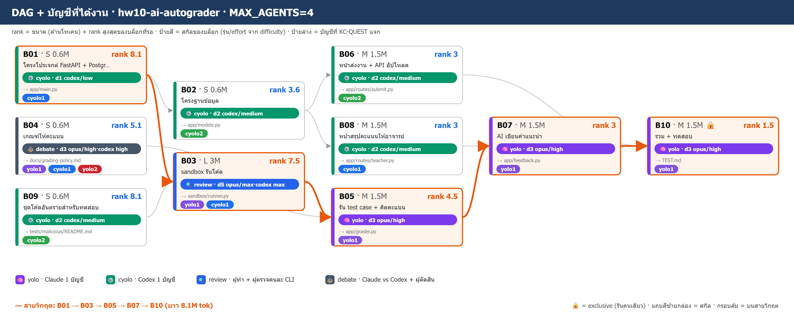
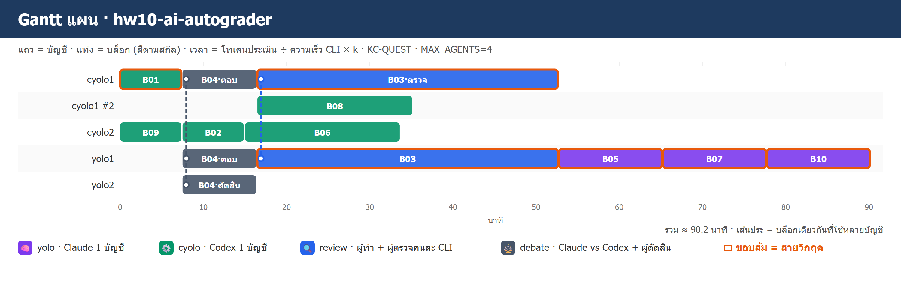

# PLAN · hw10-ai-autograder

**โจทย์:** ระบบส่งการบ้านเขียนโปรแกรม รันโค้ดนักศึกษาใน sandbox (Docker) ตรวจด้วย test case ให้ AI เขียนคำแนะนำ และสรุปคะแนนให้อาจารย์

วางแผนเมื่อ 15/11/2026 14:10 · MAX_AGENTS 4 · บัญชี cyolo1, cyolo2, yolo1, yolo2 · ตัวปรับเวลา k (ยังไม่มี calib.json → k=1)

> แผนนี้ยังไม่ได้รันจริง — KC-QUEST เลือกบัญชีจากโควตา แล้วจำลองเวลาตาม dependency

## 1) โควตาของแต่ละบัญชี

| บัญชี | แพลน | ใช้ไป 5 ชม. | ใช้ไปสัปดาห์ | headroom | รีเซ็ต/หมดอายุ (ชม.) | U | slot | ที่มา |
|---|---|---|---|---|---|---|---|---|
| cyolo1 | default | 10% | 0% | **90%** | 168.0 | 0.125 | 3 | สมมติ (--accounts) |
| cyolo2 | default | 30% | 0% | **70%** | 168.0 | 0.125 | 3 | สมมติ (--accounts) |
| yolo1 | default | 20% | 0% | **80%** | 168.0 | 0.125 | 3 | สมมติ (--accounts) |
| yolo2 | default | 40% | 0% | **60%** | 168.0 | 0.125 | 3 | สมมติ (--accounts) |

- ⚠ ทุกบัญชีเป็นค่าสมมติ (--accounts มี % ครบ) → ไม่ได้เรียก team.py check/quota

## 2) DAG + สกิล + บัญชี

**สายวิกฤต:** B01 → B03 → B05 → B07 → B10 · ยาว 8.1M tok

## 3) ตารางแจกงาน (เหตุผล KC-QUEST ทุกบล็อก)

| บล็อก | สกิล | ชื่อ | ขนาด · c | รอ | rank | บัญชี (บทบาท) | เริ่ม–จบ (นาที) | เหตุผล KC-QUEST |
|---|---|---|---|---|---|---|---|---|
| **B01** | ⚙️ cyolo | โครงโปรเจกต์ FastAPI + PostgreSQL | S · 0.6 | – | 8.1 | cyolo1 (ทำ) | 0.0–7.5 | ทำ: cyolo1 28.8 (U=0.125 F=0.002 S=0.884 S=0.7 L=0.0) · 0.60M ≈ 5ชม. 1.56% / สัปดาห์ 0.2% · อันดับ 2 cyolo2 25.8 |
| B09 | ⚙️ cyolo | ชุดโค้ดอันตรายสำหรับทดสอบ | S · 0.6 | – | 8.1 | cyolo2 (ทำ) | 0.0–7.5 | ทำ: cyolo2 25.8 (U=0.125 F=0.002 S=0.684 S=0.7 L=0.0) · 0.60M ≈ 5ชม. 1.56% / สัปดาห์ 0.2% · อันดับ 2 cyolo1 25.2 |
| B04 | ⚖️ debate | เกณฑ์ให้คะแนน | S · 0.6 | – | 5.1 | yolo1 (ตอบ), cyolo1 (ตอบ), yolo2 (ตัดสิน) | 7.5–16.5 | ตอบ: yolo1 26.2 (U=0.125 F=0.002 S=0.784 S=0.63 L=0.0) · 0.60M ≈ 5ชม. 1.56% / สัปดาห์ 0.2% · อันดับ 2 yolo2 23.2   ตอบ: cyolo1 24.7 (U=0.125 F=0.002 S=0.869 S=0.441 L=0.0) · 0.60M ≈ 5ชม. 1.56% / สัปดาห์ 0.2% · อันดับ 2 cyolo2 21.7   ตัดสิน: yolo2 23.4 (U=0.125 F=0.001 S=0.595 S=0.63 L=0.0) · 0.18M ≈ 5ชม. 0.47% / สัปดาห์ 0.06% · อันดับ 2 cyolo2 21.8 |
| B02 | ⚙️ cyolo | โครงฐานข้อมูล | S · 0.6 | B01 | 3.6 | cyolo2 (ทำ) | 7.5–15.0 | ทำ: cyolo2 19.7 (U=0.125 F=0.002 S=0.669 S=0.311 L=0.0) · 0.60M ≈ 5ชม. 1.56% / สัปดาห์ 0.2% · อันดับ 2 cyolo1 19.2 |
| B06 | ⚙️ cyolo | หน้าส่งงาน + API อัปโหลด | M · 1.5 | B02 | 3 | cyolo2 (ทำ) | 15.0–33.8 | ทำ: cyolo2 18.4 (U=0.125 F=0.005 S=0.63 S=0.259 L=0.0) · 1.50M ≈ 5ชม. 3.9% / สัปดาห์ 0.49% · อันดับ 2 cyolo1 18.1 |
| **B03** | 🔍 review | sandbox รันโค้ด | L · 3 | B01, B09 | 7.5 | yolo1 (ทำ), cyolo1 (ตรวจ) | 16.5–52.8 | ทำ: yolo1 29.7 (U=0.125 F=0.01 S=0.706 S=0.926 L=0.0) · 3.00M ≈ 5ชม. 7.8% / สัปดาห์ 0.98% · อันดับ 2 yolo2 26.8   ตรวจ: cyolo1 23.5 (U=0.125 F=0.003 S=0.806 S=0.648 L=0.333) · 0.90M ≈ 5ชม. 2.34% / สัปดาห์ 0.29% · อันดับ 2 cyolo2 20.5 |
| B08 | ⚙️ cyolo | หน้าสรุปคะแนนให้อาจารย์ | M · 1.5 | B02 | 3 | cyolo1 (ทำ) | 16.5–35.2 | ทำ: cyolo1 21.4 (U=0.125 F=0.005 S=0.83 S=0.259 L=0.0) · 1.50M ≈ 5ชม. 3.9% / สัปดาห์ 0.49% · อันดับ 2 cyolo2 14.5 |
| **B05** | 🧠 yolo | รัน test case + คิดคะแนน | M · 1.5 | B03, B04 | 4.5 | yolo1 (ทำ) | 52.8–65.2 | ทำ: yolo1 23.4 (U=0.125 F=0.005 S=0.667 S=0.556 L=0.0) · 1.50M ≈ 5ชม. 3.9% / สัปดาห์ 0.49% · อันดับ 2 yolo2 21.8 |
| **B07** | 🧠 yolo | AI เขียนคำแนะนำ | M · 1.5 | B05 | 3 | yolo1 (ทำ) | 65.2–77.7 | ทำ: yolo1 20.1 (U=0.125 F=0.005 S=0.628 S=0.37 L=0.0) · 1.50M ≈ 5ชม. 3.9% / สัปดาห์ 0.49% · อันดับ 2 yolo2 19.0 |
| **B10** | 🧠 yolo | รวม + ทดสอบ | M · 1.5 | B06, B07, B08 | 1.5 | yolo1 (ทำ) | 77.7–90.2 | ทำ: yolo1 16.7 (U=0.125 F=0.005 S=0.589 S=0.185 L=0.0) · 1.50M ≈ 5ชม. 3.9% / สัปดาห์ 0.49% · อันดับ 2 yolo2 16.2 |

## 4) Gantt แผน

## 5) รอบแจกงาน

| นาทีที่ | บล็อกที่เริ่ม |
|---|---|
| 0 | B01→cyolo1, B09→cyolo2 |
| 7.5 | B04→yolo1+cyolo1+yolo2, B02→cyolo2 |
| 15 | B06→cyolo2 |
| 16.5 | B08→cyolo1, B03→yolo1+cyolo1 |
| 52.8 | B05→yolo1 |
| 65.2 | B07→yolo1 |
| 77.7 | B10→yolo1 |

## 6) สรุป

- บล็อก 10 · แจกได้ 10 · agent พร้อมกันสูงสุด 4/4
- เวลาประมาณ 90.2 นาที (แท่ง Gantt) · ไฟล์ผลของทีม: `C:/CWN2026-homework/.work/plans\hw10-ai-autograder\app/`

ต่อไป: `dagplan.py export hw10-ai-autograder` → `dagplan.py run hw10-ai-autograder` → `dagplan.py report hw10-ai-autograder`
